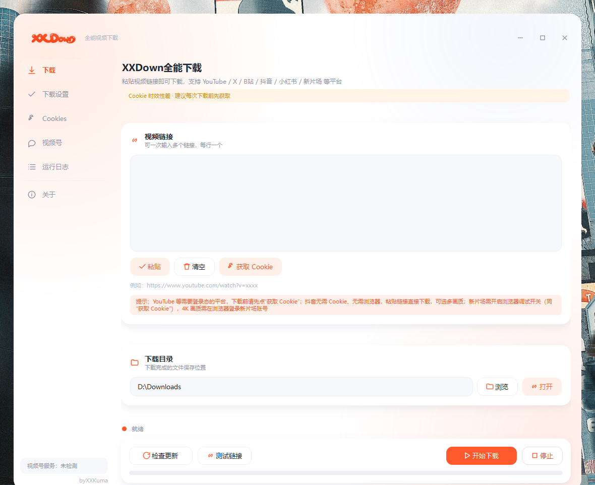
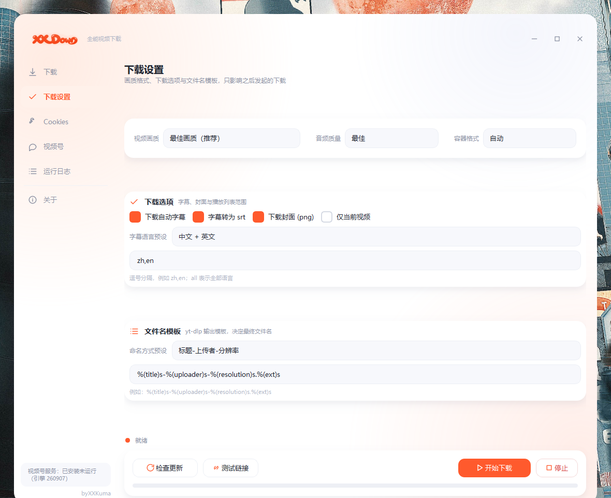

# XX Down —— 全能视频下载

基于开源项目 [yt-dlp](https://github.com/yt-dlp/yt-dlp) 打造的 Windows 桌面视频下载器，
双击即用，无需安装任何环境。

[English README](README_EN.md)




## 功能特性

- **多平台支持**：抖音（免登录、多画质）、新片场、微信视频号、小红书、YouTube、B站、X(Twitter) 等
- **画质选择**：最佳 / 8K / 4K / 2K / 1080p / 720p / 480p / 360p / 仅音频；音频质量 320K ~ 64K
- **字幕与封面**：自动字幕下载（可转 srt）、封面图下载
- **一键更新 yt-dlp**：始终使用最新解析能力
- **Cookies 一键获取**：直连运行中的 Chrome/Edge（官方 autoConnect）导出登录态
- **微信视频号**：复用开源引擎 [ltaoo/wx_channels_download](https://github.com/ltaoo/wx_channels_download)，首次使用自动下载
- **系统通知**：下载完成 / 失败时弹出 Windows 通知（以 XX Down 本身身份显示）
- **文件名模板**：可自定义 yt-dlp 输出模板

## 架构

```
XX Down.exe（C 启动器，MinGW 编译）
    └── python/pythonw.exe（官方 CPython 3.13 embeddable，微软签名）
            └── ytdlp_gui.py（PySide6 GUI + yt-dlp/ffmpeg 调度）
```

- 启动器是一个小 C 程序：拉起内置运行时，并代为发送 Windows 通知
  （通知身份是启动器本身，而不是 Python 进程）
- 为什么不用 PyInstaller：360 杀毒的启发式规则（Trojan/Python.ShellLoader.am）
  会误杀本应用的 PyInstaller 包；官方签名的 CPython 运行时 + 小 C 启动器的
  组合不触发误报
- 抖音解析：直连抖音官方 Web API（无需登录、无需浏览器）
- 新片场解析：真实浏览器打开视频页读取 `__NEXT_DATA__` + 会话 Cookie，
  再请求 CDN 直链（4K 需登录态）

## 目录结构

```
XX-Down/
├── ytdlp_gui.py          主程序（PySide6 GUI + 下载调度）
├── launcher.c            C 启动器源码（构建时编译为 XX Down.exe）
├── 使用说明.txt          用户手册（中文）
├── 使用说明_EN.txt       用户手册（英文）
├── docs/
│   ├── screenshot.png            界面截图
│   └── screenshot_settings.png   下载设置页截图
└── build/
    ├── build_exe.py      构建脚本（组装运行时 + 冒烟测试）
    ├── installer.iss     Inno Setup 6 安装包脚本
    ├── ChineseSimplified.isl
    └── xlogo4.ico        应用图标
```

## 构建（Windows x64）

### 1. 安装工具链

- [LLVM MinGW](https://github.com/mstorsjo/llvm-mingw)（提供 gcc / windres）：
  `winget install MartinStorsjo.LLVM-MinGW.UCRT`
- [Inno Setup 6](https://jrsoftware.org/isinfo.php)（打包安装包）

### 2. 准备第三方依赖（放入 `vendor/`，该目录不入库）

| 依赖 | 获取方式 |
| --- | --- |
| `vendor/python-3.13.11-embed-amd64.zip` | [python.org](https://www.python.org/ftp/python/3.13.11/python-3.13.11-embed-amd64.zip) |
| `vendor/pyside/`（PySide6 6.11.2 + shiboken6） | `pip download PySide6-Essentials==6.11.2 shiboken6==6.11.2 --no-deps -d tmp`，解压两个 wheel 到 `vendor/pyside/` |
| `vendor/site-packages/`（pywin32 311 / win10toast 0.9 / setuptools 80.10.2） | `pip download pywin32==311 win10toast==0.9 setuptools==80.10.2 --no-deps -d tmp`，解压 wheel 内容到 `vendor/site-packages/` |
| `vendor/bin/yt-dlp.exe` | [yt-dlp releases](https://github.com/yt-dlp/yt-dlp/releases) |
| `vendor/bin/ffmpeg.exe`、`ffprobe.exe` | [gyan.dev ffmpeg builds](https://www.gyan.dev/ffmpeg/builds/)（essentials 版） |
| `vendor/bin/deno.exe` | [deno releases](https://github.com/denoland/deno/releases) |

### 3. 构建

```powershell
python build\build_exe.py        # 组装 XX Down.exe + python\ + .install\（含冒烟测试）
& "C:\Program Files (x86)\Inno Setup 6\ISCC.exe" build\installer.iss
# 产物：XX Down_安装包_v1.5.exe
```

## 第三方依赖与致谢

| 组件 | 许可证 | 用途 |
| --- | --- | --- |
| [yt-dlp](https://github.com/yt-dlp/yt-dlp) | BSD-3-Clause | 下载引擎 |
| [ffmpeg](https://ffmpeg.org) | LGPL-2.1 / GPL-3.0 | 音视频合并 / 转换 |
| [PySide6](https://www.qt.io) | LGPL-3.0 / 商业 | GUI |
| [CPython](https://www.python.org) | PSF | 内置运行时 |
| [pywin32](https://github.com/mhammond/pywin32) | PSF | Windows API |
| [win10toast](https://github.com/calclavia/win10toast) | 见上游 | 开发模式通知兜底 |
| [ltaoo/wx_channels_download](https://github.com/ltaoo/wx_channels_download) | 见上游 | 微信视频号引擎 |
| [Inno Setup](https://jrsoftware.org) | Freeware（非商用） | 安装包 |

## 免责声明

- 本项目仅供个人学习与个人备份使用，请尊重视频内容版权并遵守各平台服务条款
- 请勿将下载内容用于商业传播
- 因使用本软件产生的任何纠纷由使用者自行承担

## 许可证

本项目基于 [MIT 许可证](LICENSE) 开源。

## 作者

byXXKuma
