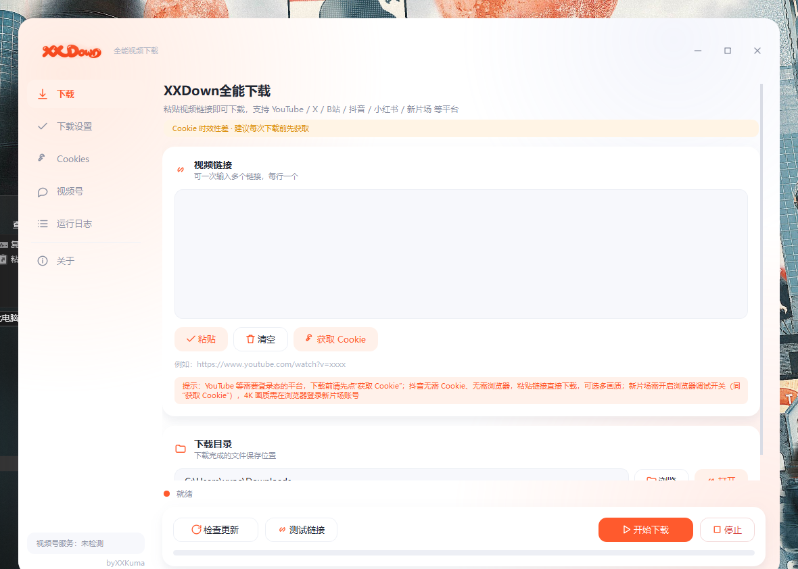
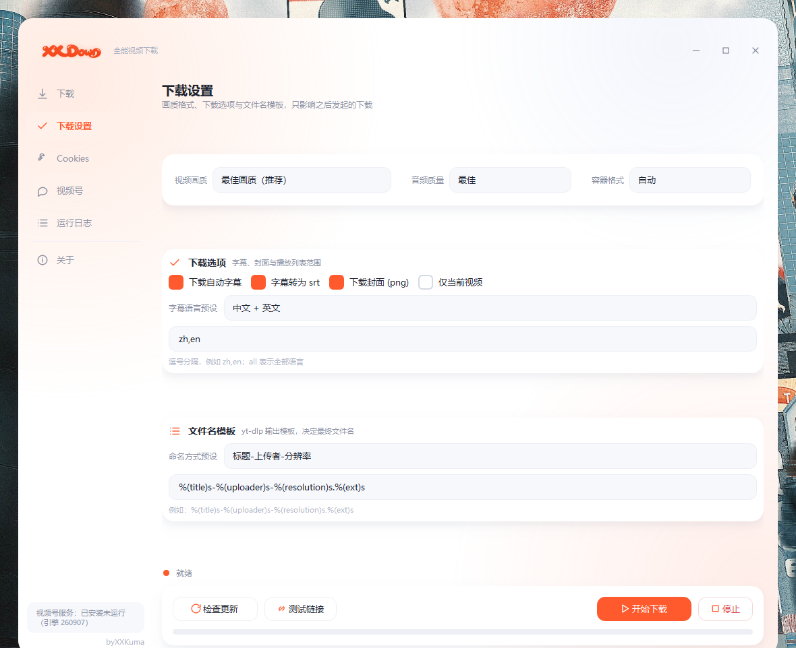

# XX Down — All-in-one Video Downloader

A Windows desktop video downloader built on the open-source project [yt-dlp](https://github.com/yt-dlp/yt-dlp).
Double-click and go — no environment setup required.

[中文版 README](README.md)




## Features

- **Multi-platform**: Douyin (no login; one default stream when the API is down), Xinpianchang, WeChat Channels, Xiaohongshu, YouTube, Bilibili, X (Twitter), and more
- **Quality selection**: Best / 8K / 4K / 2K / 1080p / 720p / 480p / 360p / audio only; audio quality 320K ~ 64K
- **Subtitles & thumbnails**: automatic subtitle download (convertible to .srt), thumbnail download
- **Full-app auto-update**: checks GitHub Releases, downloads the setup package and installs it silently (GitHub direct -> ghfast.top -> gh-proxy.com)
- **One-click yt-dlp update**: always use the latest extraction capabilities
- **One-click Cookies**: connects directly to a running Chrome/Edge (official autoConnect) to export login state
- **WeChat Channels**: reuses the open-source engine [ltaoo/wx_channels_download](https://github.com/ltaoo/wx_channels_download), auto-downloaded on first use
- **System notifications**: Windows notifications on download success / failure (shown as XX Down itself)
- **Filename templates**: customizable yt-dlp output template

## Architecture

```
XX Down.exe (C launcher, compiled with MinGW)
    └── python/pythonw.exe (official CPython 3.13 embeddable, Microsoft-signed)
            └── ytdlp_gui.py (PySide6 GUI + yt-dlp/ffmpeg orchestration)
```

- The launcher is a small C program: it starts the bundled runtime and sends
  Windows notifications on its behalf (the notification identity is the launcher
  itself, not the Python process)
- Why not PyInstaller: 360 AV's heuristic rule (Trojan/Python.ShellLoader.am)
  quarantines PyInstaller builds of this app; the combination of the official
  signed CPython runtime + a small C launcher does not trigger the false positive
- Douyin: tries the official web API first, then automatically falls back to browser interception when it returns 403 (signature checks); no login, but Chrome/Edge must run with Remote debugging on
- Xinpianchang: opens the video page in a real browser, reads `__NEXT_DATA__`
  plus session cookies, then requests the CDN direct link (4K requires login)

## Repository layout

```
XX-Down/
├── ytdlp_gui.py          main program (PySide6 GUI + download orchestration)
├── launcher.c            C launcher source (compiled to XX Down.exe at build time)
├── xxdown_cli.py         agent CLI (same engines as the GUI, JSON output)
├── 使用说明.txt          user manual (Chinese)
├── 使用说明_EN.txt       user manual (English)
├── docs/
│   ├── screenshot.png            main window screenshot
│   └── screenshot_settings.png   download settings screenshot
└── build/
    ├── build_exe.py      build script (assembles runtime + smoke test)
    ├── installer.iss     Inno Setup 6 installer script
    ├── ChineseSimplified.isl
    └── xlogo4.ico        app icon
```

## Building (Windows x64)

### 1. Toolchain

- [LLVM MinGW](https://github.com/mstorsjo/llvm-mingw) (provides gcc / windres):
  `winget install MartinStorsjo.LLVM-MinGW.UCRT`
- [Inno Setup 6](https://jrsoftware.org/isinfo.php) (installer packaging)

### 2. Third-party dependencies (place in `vendor/`, not committed)

| Dependency | How to obtain |
| --- | --- |
| `vendor/python-3.13.11-embed-amd64.zip` | [python.org](https://www.python.org/ftp/python/3.13.11/python-3.13.11-embed-amd64.zip) |
| `vendor/pyside/` (PySide6 6.11.2 + shiboken6) | `pip download PySide6-Essentials==6.11.2 shiboken6==6.11.2 --no-deps -d tmp`, unpack the two wheels into `vendor/pyside/` |
| `vendor/site-packages/` (pywin32 311 / win10toast 0.9 / setuptools 80.10.2) | `pip download pywin32==311 win10toast==0.9 setuptools==80.10.2 --no-deps -d tmp`, unpack the wheel contents into `vendor/site-packages/` |
| `vendor/bin/yt-dlp.exe` | [yt-dlp releases](https://github.com/yt-dlp/yt-dlp/releases) |
| `vendor/bin/ffmpeg.exe`, `ffprobe.exe` | [gyan.dev ffmpeg builds](https://www.gyan.dev/ffmpeg/builds/) (essentials) |
| `vendor/bin/deno.exe` | [deno releases](https://github.com/denoland/deno/releases) |

### 3. Build

```powershell
python build\build_exe.py        # assembles XX Down.exe + python\ + .install\ (with smoke test)
```

## Release automation

Change APP_VERSION in ytdlp_gui.py and push to main: GitHub Actions builds the Windows installer and creates the matching v<version> tag and Release automatically. The GUI full-app updater checks this same Release for updates.

```powershell
& "C:\Program Files (x86)\Inno Setup 6\ISCC.exe" build\installer.iss
# output: XX Down_安装包_v1.5.exe
```

## Agent CLI (xxdown_cli.py)

A headless command-line entry point for local scripts and AI agents. It calls the same engine functions as the GUI, so it shares one yt-dlp.exe, one cookies.txt and one settings file with the interface: an agent never downloads yt-dlp again or exports cookies over and over. Links already downloaded return their local file path without touching the network. Bookkeeping has two layers, a local index xxdown_index.jsonl plus the yt-dlp archive xxdown_archive.txt. --force re-downloads. The build script ships the file inside the installer.

```
python\python.exe xxdown_cli.py tools                 # self-description: commands, exit codes, allowed values
python\python.exe xxdown_cli.py doctor                # environment, versions, cookie state, problems
python\python.exe xxdown_cli.py resolve <URL>         # inspect title and formats, no download
python\python.exe xxdown_cli.py download <URL> [<URL>...] --quality 1080p
python\python.exe xxdown_cli.py history --url <URL>   # was this link already downloaded?
python\python.exe xxdown_cli.py cookies status|grab|validate
python\python.exe xxdown_cli.py wx status|install|start|stop|tasks
python\python.exe xxdown_cli.py update                # updates the local yt-dlp / deno
```

Contract: stdout is exactly one JSON document, progress and logs go to stderr (--quiet silences them), no dialogs and no GUI start-up. Exit codes: 0 success (including a dedup hit), 1 some link failed, 2 bad arguments, 3 missing environment, 130 interrupted. XX Down.exe still forwards its arguments to the GUI, so agents should call python\python.exe xxdown_cli.py directly.

## Third-party dependencies & credits

| Component | License | Purpose |
| --- | --- | --- |
| [yt-dlp](https://github.com/yt-dlp/yt-dlp) | BSD-3-Clause | download engine |
| [ffmpeg](https://ffmpeg.org) | LGPL-2.1 / GPL-3.0 | audio/video muxing / conversion |
| [PySide6](https://www.qt.io) | LGPL-3.0 / commercial | GUI |
| [CPython](https://www.python.org) | PSF | bundled runtime |
| [pywin32](https://github.com/mhammond/pywin32) | PSF | Windows API |
| [win10toast](https://github.com/calclavia/win10toast) | see upstream | notifications in dev mode |
| [ltaoo/wx_channels_download](https://github.com/ltaoo/wx_channels_download) | see upstream | WeChat Channels engine |
| [Inno Setup](https://jrsoftware.org) | Freeware (non-commercial) | installer |

## Disclaimer

- This project is for personal learning and personal backup use only. Please respect content copyright and each platform's terms of service.
- Do not use downloaded content for commercial distribution.
- The user is solely responsible for any disputes arising from the use of this software.

## License

This project is open-sourced under the [MIT License](LICENSE).

## Author

byXXKuma
